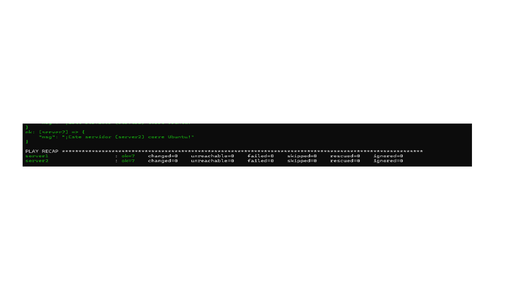

# Ansible Lab con Docker

## Objetivo de la práctica
Aprender a automatizar la configuración de servidores usando Ansible, administrando dos contenedores Docker (Ubuntu 24.04) mediante un inventario y un playbook que usa facts, loops y condicionales.

## Iniciar los contenedores
```bash
docker compose up -d
docker ps
docker exec server1 bash -c "apt update && apt install -y python3"
docker exec server2 bash -c "apt update && apt install -y python3"
```

## Probar la conexión
```bash
ansible docker -i inventory.ini -m ping
```

## Ejecutar el playbook
```bash
ansible-playbook -i inventory.ini playbook.yml
```

## Captura de la ejecución exitosa

